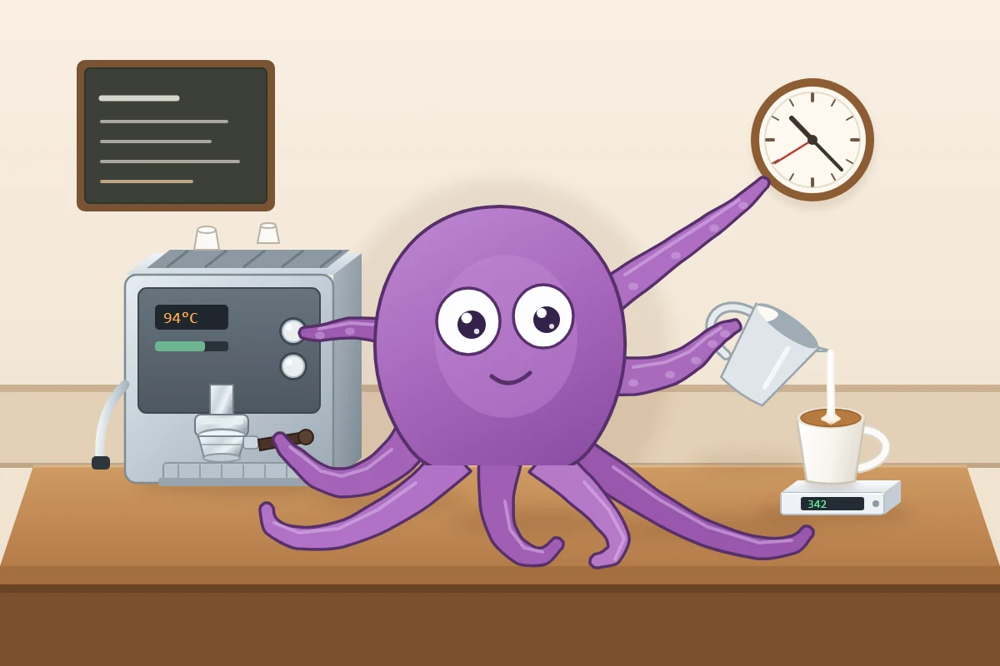
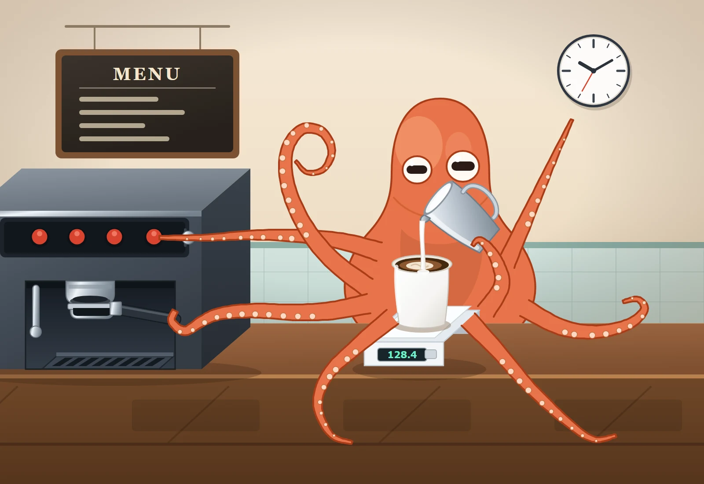
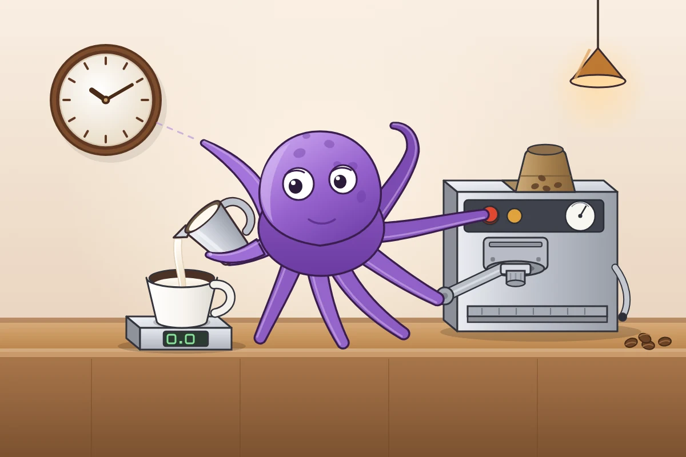
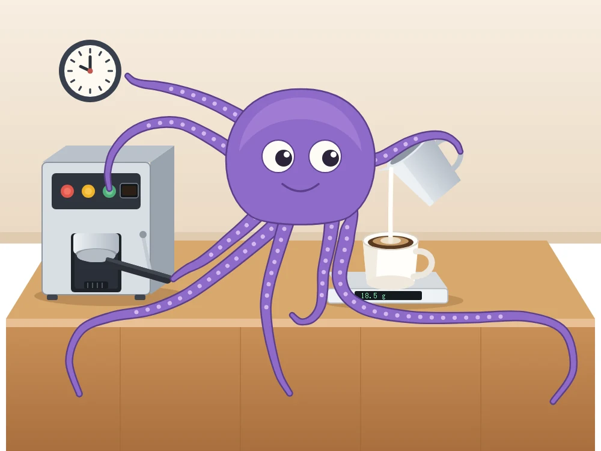
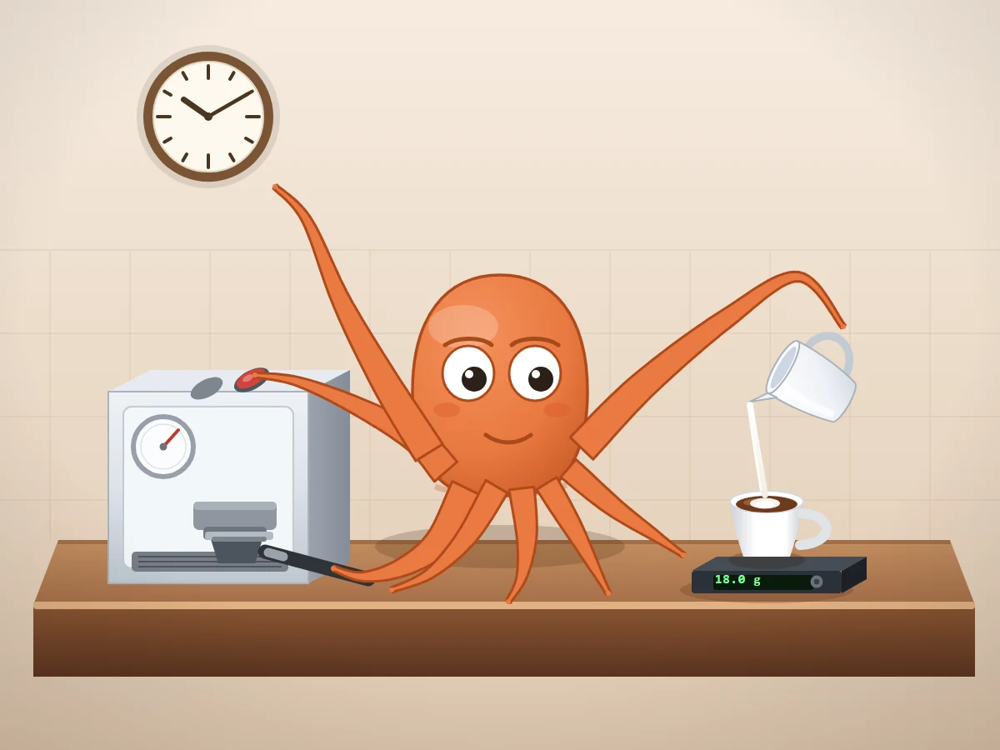

# Octopus Barista Test

[中文](README.md) · [English](README.en.md)

A single-prompt benchmark that probes an AI coding agent's **spatial reasoning, multi-constraint execution and code generation**. Inspired by the Pelican Test (asking a model to draw a pelican riding a bicycle).

> Same model, same prompt, different agent tools — see who actually gets all eight tentacles to do their job.

## What makes it harder than the Pelican Test

The Pelican Test mainly checks whether two objects (bird, bicycle) are put together correctly. This one concentrates the pressure on four things:

| Aspect | What it probes |
| --- | --- |
| Visual structure | Can it represent eight tentacles and several independent objects at once? |
| Spatial reasoning | Do contact, support, direction and occlusion actually make sense? |
| Multi-constraint execution | Does it satisfy every requirement, not just the most obvious one? |
| Code generation | Is the output valid, self-contained, renderable SVG? |

Drawing eight tentacles is not the hard part. The hard part is **giving every tentacle a different job while keeping the whole scene spatially coherent**.

## The prompt

The full prompt is in [prompt.md](prompt.md). Paste it verbatim; no extra tool instructions are needed.

## Scoring (20 items, 0.5 points each, 10 points total)

All 20 items are **equally weighted**. Weighting them would mean everyone argues about the weights rather than about the work; equal weight keeps any dispute focused on whether a specific item was judged correctly.

| # | 检查项 | 通过标准 |
| --- | --- | --- |
| 1 | Tentacle count | Exactly eight |
| 2 | Tentacle separation | All eight are distinguishable; none merged or duplicated |
| 3 | Handle grip | One tentacle touches the portafilter handle |
| 4 | Handle position | The handle sits under the machine's group head, in a plausible position |
| 5 | Pitcher grip | The pitcher is held by a tentacle, not floating |
| 6 | Pitcher pose | The pitcher's tilt is consistent with pouring |
| 7 | Stream continuity | The milk stream is not broken |
| 8 | Stream endpoint | The stream ends inside the cup rim, not outside |
| 9 | Button exists | The espresso machine has a recognisable button |
| 10 | Button touch | One tentacle actually touches the button |
| 11 | Pointing action | One tentacle is extended toward the wall clock |
| 12 | Pointing accuracy | That tentacle's extended axis points at the clock face; no dashed line or arrow stands in for it |
| 13 | Cup and scale present | Both the coffee cup and the digital scale are present and recognisable |
| 14 | Cup on scale | The cup rests directly on the scale, surfaces in contact |
| 15 | Scene support | Machine and scale both rest on the countertop |
| 16 | Remaining limbs | The remaining four tentacles are clearly visible |
| 17 | Limb connection | Every tentacle is connected to the body, none enters from off-screen |
| 18 | Occlusion | Occlusion is consistent; objects do not visibly interpenetrate |
| 19 | Tentacle overlap | Tentacles do not overlap each other over large areas |
| 20 | SVG engineering | Valid, self-contained SVG that renders correctly |

The last item is enforced by CI on every push. Run it locally before submitting (see [CONTRIBUTING.md](CONTRIBUTING.md)):

```bash
node scripts/check-svg.mjs
```

**Principle**: a pretty drawing does not earn points. Gorgeous artwork with only six tentacles, or milk pouring outside the cup, still loses points.

## Results of this run

Model **DeepSeek-V4.1-Flash**, five different agent tools, one generation each, same prompt.

| Rank | Agent tool | Work | Score | Deduction |
| --- | --- | --- | --- | --- |
| 1 | ChatGPT | [chatgpt.svg](results/chatgpt.svg) | **10.0** | none |
| 2 (tie) | ZCode | [zcode.svg](results/zcode.svg) | **9.5** | item 19, tentacle overlap |
| 2 (tie) | WorkBuddy | [workbuddy.svg](results/workbuddy.svg) | **9.5** | item 12, pointing |
| 2 (tie) | DeepSeek Harness | [deepseek-harness.svg](results/deepseek-harness.svg) | **9.5** | item 19, tentacle overlap |
| 2 (tie) | Claude | [claude.svg](results/claude.svg) | **9.5** | item 5, pitcher grip |

Every item carries equal weight, so the things the original review used to separate these works (a floating pitcher, tentacle overlap, detail density) are worth at most 0.5 each — the four land in the same band. The tie is the normal outcome of this scheme, not a missed deduction: if you disagree, point at the item that was judged wrongly. See [results/SCORES.md](results/SCORES.md).

Full commentary: [results/SCORES.md](results/SCORES.md).
Run environment and artefact sizes: [results/MANIFEST.md](results/MANIFEST.md).

### Preview

| **#1 ChatGPT · 10.0** | **#2 ZCode · 9.5** |
| --- | --- |
|  |  |
| **#2 WorkBuddy · 9.5** | **#2 DeepSeek Harness · 9.5** |
|  |  |
| **#2 Claude · 9.5** | |
|  | |

Open [index.html](index.html) in a browser for the gallery — static, no build step, works as-is on GitHub Pages.

## Repository layout

```
prompt.md                The prompt — copy and paste
CONTRIBUTING.md          Submission requirements
README.en.md             English
results/*.svg            Each agent tool's output (the only artefact that is scored)
results/SCORES.md        Scoring basis and per-work commentary
results/MANIFEST.md      Run record: environment and artefact sizes
scripts/check-svg.mjs    Self-containment check, run by CI and before submitting
scripts/render.mjs       SVG to PNG, for previews
scripts/<agent>/         Scripts the agents left behind; reference only
index.html               Gallery
```

## Running it yourself

1. Start a fresh agent session and paste the prompt from [prompt.md](prompt.md) verbatim.
2. Save the returned SVG, render it, and check it item by item against the checklist above — **structure first, beauty second**.
3. Prefer three independent runs per agent tool and compare the mean and minimum, not a single result.

## Notes

- This repository includes results from five agent tools only.
- A single run does not represent the overall ability of an agent tool or a model, and cannot be used to conclude that an API has been "nerfed". Model output is stochastic; prompt, reasoning effort and runtime all matter.
- CI runs `node scripts/check-svg.mjs` on every push; any invalid SVG, or one containing raster data, fails the build.
- The scripts under `scripts/<agent>/` were left behind during generation. Their style and quality vary widely; they are not part of the test and are not scored. `scripts/check-svg.mjs` and `scripts/render.mjs` are the exception — they are tooling, not outputs.

## License

MIT — see [LICENSE](LICENSE). Author: [@ForestSun2023](https://github.com/ForestSun2023).
